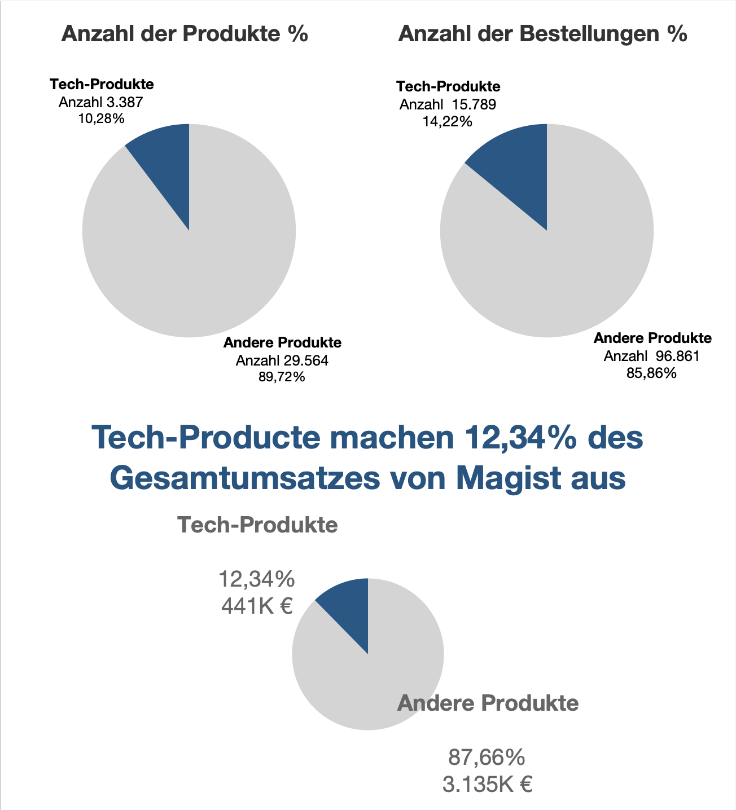
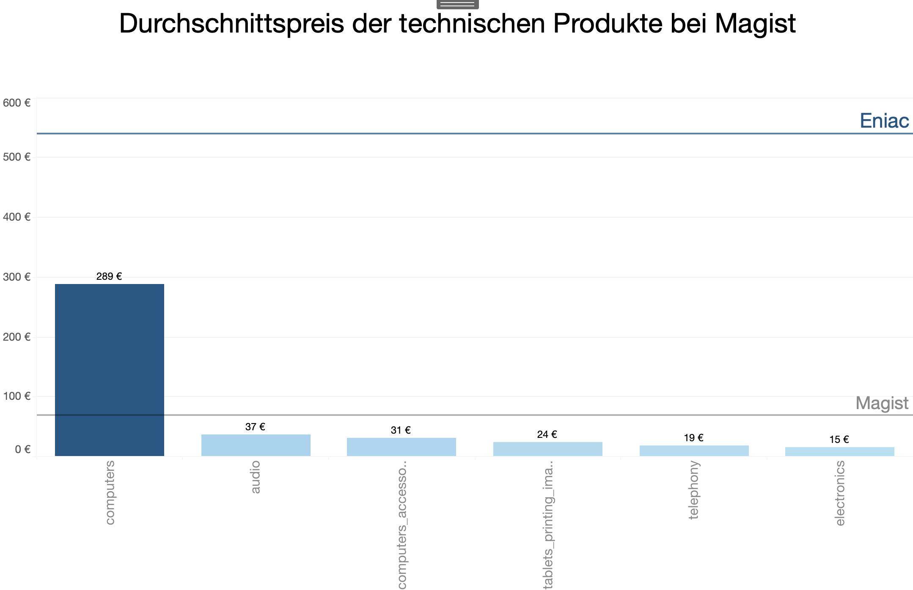
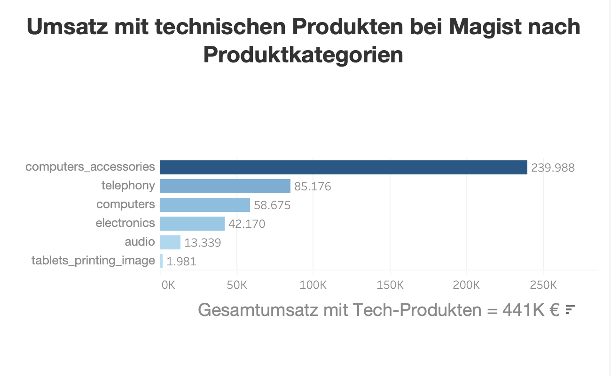

# Tableau Analysis

This folder contains Tableau visualizations and supporting materials
for the Enica through Magist Brazil market entry analysis.

## Overview

The dashboards present quantitative and financial indicators examined to support the assessment of Enica's potential market entry into Brazil through Magist.

## Dashboard Preview

### Quantitative Indicators

This dashboard presents the quantitative indicators analyzed in the project.

## Supporting Visualizations

### Average Price Analysis

This visualization presents the price indicators examined in the analysis.

### Profit by Category

This visualization presents the category-level financial indicators examined in the analysis.

## Tableau Workbook

Download the packaged Tableau workbook to explore the analysis in Tableau Desktop.

[**Download Tableau Workbook (.twbx)**](eniac-magist-analysis.twbx)

The workbook contains the Tableau visualizations developed for this project. Depending on the data connections used, some data sources may need to be available separately.

## Business Context

The visualizations support the evaluation of whether Enica should enter the Brazilian market through Magist.

The findings should be interpreted in the context of the available dataset, analytical methods, and data limitations.

## Related Project Materials

- [Main Project README](../README.md)

- [SQL Analysis](../MAGIST%20sql-queries%20datei%20analysis.sql)

- [Business Presentation](../Presentation%20Analysis%20Magist.pdf)
